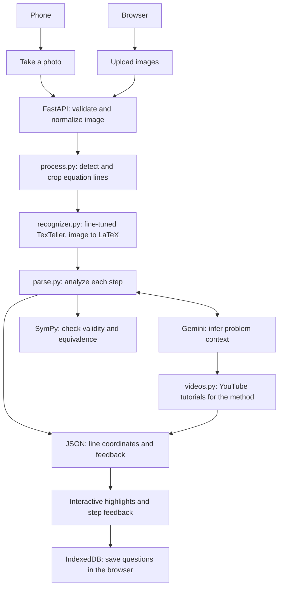

# Snap Solve

A workspace for checking handwritten math, one step at a time. Upload a photo or
use your camera, select a line of work, and inspect its feedback alongside the
original image.

Snap Solve combines a FastAPI backend with a lightweight HTML, CSS, and JavaScript
frontend. Questions, images, and results are saved locally in the browser using
IndexedDB.

The processing pipeline is designed around a **fine-tuned TexTeller AI model**
for handwritten image-to-LaTeX recognition, SymPy for math validation, and Gemini
for problem context.



## What the website needs

| Piece | What it does | Without it |
| --- | --- | --- |
| Python 3.12 and `requirements.txt` | The page, uploads, line detection, and SymPy checks | The site won't start |
| Model packages: PyTorch, torchvision, and `texteller`, from `requirements-training.txt` | Read each line as LaTeX. `texteller` installs Hugging Face `transformers` (pinned to 4.47) itself | Lines are found but never read, so **nothing gets checked** |
| The fine-tuned checkpoint, `checkpoints/texteller_mixed/best` (about 1.2 GB, not in Git) | The trained weights the model packages load | Same as above |
| `GEMINI_API_KEY` in `.env` | Works out what problem is being solved, checks the final answer against it, and picks the video search phrase | Steps are still checked against each other, but there's no problem context, final-answer check, or videos |
| `YOUTUBE_API_KEY` in `.env` | Related tutorial videos (needs Gemini too, since Gemini picks the search phrase) | No videos |

So the model packages and the checkpoint are needed for the site to do its job;
only the two API keys are truly optional.

`requirements-training.txt` also installs a few packages only training and
evaluation use (`editdistance`, `tqdm`, `pandas`, `pyarrow`); they're small and
harmless on a server. `texteller` itself pulls in large extras the site never
imports (Streamlit, Ray, ONNX Runtime), so expect the environment to take
several GB of disk.

## Run locally

From the repository root. Python 3.12 is recommended (`texteller` needs 3.10 or
newer).

### 1. Create an environment

Conda:

```bash
conda create --name snap-solve python=3.12 pip -y
conda activate snap-solve
```

Or pip and venv:

```bash
python -m venv .venv
source .venv/bin/activate
```

On Windows PowerShell, activate with `.venv\Scripts\Activate.ps1` instead.

### 2. Install the packages

```bash
python -m pip install -r requirements.txt
python -m pip install -r requirements-training.txt
```

Then check that PyTorch can use the GPU:

```bash
python -c "import torch; print(torch.__version__, torch.cuda.is_available())"
```

On a machine with an NVIDIA card this should print a version ending in `+cu…`
and `True`. If it prints `+cpu` or `False`, see
[Getting the CUDA build of PyTorch](#getting-the-cuda-build-of-pytorch). The
site still works on the CPU, just slower.

### 3. Add the model and keys

1. Copy the checkpoint's `best` folder to `checkpoints/texteller_mixed/best`, or
   set `TEXTELLER_MODEL_DIR` in `.env` to wherever it is.
2. Copy `.env.example` to `.env` and fill in your keys.

| Setting in `.env` | Meaning |
| --- | --- |
| `GEMINI_API_KEY` | Gemini key (`GOOGLE_API_KEY` also works) |
| `GEMINI_MODEL` or `GEMINI_MODELS` | Model, or a comma-separated list tried in order when one runs out of quota. Default: `gemini-3.5-flash,gemini-3.5-flash-lite,gemini-2.5-flash` |
| `YOUTUBE_API_KEY` | YouTube Data API key for related videos |
| `TEXTELLER_MODEL_DIR` | Checkpoint folder. Default: `checkpoints/texteller_mixed/best` |
| `TEXTELLER_DEVICE` | `cuda` or `cpu`. Default: the GPU when PyTorch can see one |

Restart the server after editing `.env`.

### 4. Start the server

```bash
python -m uvicorn app:app --reload
```

Open **http://localhost:8000**.

The model loads in the background as the server starts, and the console says
how it went: `Handwriting model loaded from … on <GPU name>` when it worked, or
`Handwriting recognition is off: …` with the reason when it didn't. With
`--reload`, every saved code change restarts the server and loads the model
again; leave `--reload` off when you aren't editing code.

## Architecture

`process.py` handles images and LaTeX extraction; `parse.py` owns LaTeX parsing,
validity checks, step comparison, and Gemini calls. Slow processing runs in a
thread pool so it does not block the server's event loop.

| Location | Responsibility |
| --- | --- |
| `app.py` | Routes, upload limits, image normalization, and background processing |
| `process.py` | Line detection and in-memory crops; hands crops to `recognizer.py`, then the LaTeX to `parse.py` and the search phrase to `videos.py` |
| `recognizer.py` | Loads the fine-tuned TexTeller model and reads line crops as LaTeX |
| `parse.py` | SymPy checks and Gemini problem context |
| `videos.py` | YouTube search for tutorials on the problem's method |
| `templates/`, `static/` | Interface, image overlays, sidebar, and browser storage |
| `equation_cropper/` | Standalone tool for preparing equation crops |
| `train_texteller.py` | Fine-tuning the image-to-LaTeX model |
| `newEvaluate.py`, `latex_metrics.py` | Recognition evaluation and shared metrics |
| `mathwriting_prep.py` | Preparing MathWriting images and labels |

Website uploads are processed in memory rather than saved to server disk.
Browser-saved questions belong to the site's address and are not shared between
users or devices. The standalone cropper writes its results to its output folder.

## Training and evaluation (TexTeller)

Install the additional model dependencies:

```bash
python -m pip install -r requirements-training.txt
```

Prepare separate training and validation folders, each containing `images/` and
`labels.csv` with `filename,latex` columns. Then fine-tune and evaluate:

```bash
python train_texteller.py --train_dir data/mathwriting_train --val_dir data/mathwriting_val --out_dir checkpoints/texteller_mw
python newEvaluate.py --csv data/mathwriting_test/labels.csv --model-dir checkpoints/texteller_mw/best --out predictions.csv
```

Training dependencies target an NVIDIA CUDA setup. The best checkpoint is saved
to `<out_dir>/best`, here `checkpoints/texteller_mw/best`. The website reads
handwriting with `checkpoints/texteller_mixed/best` unless `TEXTELLER_MODEL_DIR`
points elsewhere.

### Getting the CUDA build of PyTorch

PyTorch on PyPI is CPU-only on Windows, so `requirements-training.txt` also
looks in PyTorch's own CUDA index (`cu128`, for RTX 20/30/40/50-series cards and
a recent NVIDIA driver). pip can still end up with a `+cpu` build, for example
when PyPI has a newer version number. Check with:

```bash
python -c "import torch; print(torch.__version__, torch.cuda.is_available())"
```

If it shows `+cpu` or `False`, replace PyTorch with the CUDA build, then check
again:

```bash
python -m pip install --force-reinstall --no-deps torch torchvision --index-url https://download.pytorch.org/whl/cu128
```

If pip can't find a matching version there, the
[PyTorch install page](https://pytorch.org/get-started/locally/) lists the
current CUDA index to use in place of `cu128`.

## Standalone equation cropping

Put images in `equation_cropper/input/`, then run:

```bash
python equation_cropper/crop_equations.py
```

Crops are saved under `equation_cropper/output/`, ordered down the left column,
then down the right. Use `--columns 1` for a single-column image or `--help` for
detection options. Input and output contents are ignored by Git.
