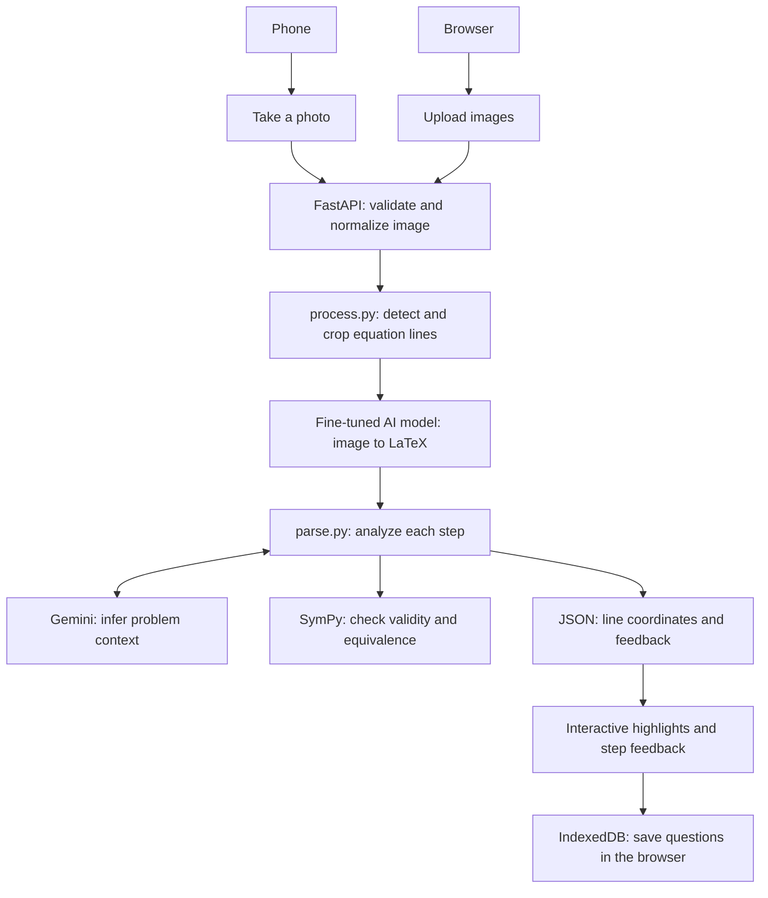

# Snap Solve

A workspace for checking handwritten math, one step at a time. Upload a photo or
use your camera, select a line of work, and inspect its feedback alongside the
original image.

Snap Solve combines a FastAPI backend with a lightweight HTML, CSS, and JavaScript
frontend. Questions, images, and results are saved locally in the browser using
IndexedDB.

The processing pipeline is designed around a **fine-tuned TexTeller AI model**
for handwritten image-to-LaTeX recognition, SymPy for math validation, and Gemini
for problem context.



## Run locally

From the repository root, choose one setup. Python 3.12 is recommended.

### Conda

```bash
conda create --name snap-solve python=3.12 pip -y
conda activate snap-solve
python -m pip install -r requirements.txt
python -m uvicorn app:app --reload
```

### pip and venv

```bash
python -m venv .venv
source .venv/bin/activate
python -m pip install -r requirements.txt
python -m uvicorn app:app --reload
```

On Windows PowerShell, activate with `.venv\Scripts\Activate.ps1` instead.

Open **http://localhost:8000**.

### Optional API configuration

For problem context and related video support, copy `.env.example` to `.env` in
the repository root and fill in your keys:

```dotenv
GEMINI_API_KEY=your-key-here
YOUTUBE_API_KEY=your-youtube-key-here
```

`parse.py` loads `.env` automatically. Restart the server after editing it.
Line detection works without API keys. Gemini requires `GEMINI_API_KEY`;
related video lookup in `videos.py` requires `YOUTUBE_API_KEY`.

## Architecture

`process.py` handles images and LaTeX extraction; `parse.py` owns LaTeX parsing,
validity checks, step comparison, and Gemini calls. Slow processing runs in a
thread pool so it does not block the server's event loop.

| Location | Responsibility |
| --- | --- |
| `app.py` | Routes, upload limits, image normalization, and background processing |
| `process.py` | Line detection, in-memory crops, and the image-to-LaTeX hook |
| `parse.py` | SymPy checks and Gemini problem context |
| `templates/`, `static/` | Interface, image overlays, sidebar, and browser storage |
| `equation_cropper/` | Standalone tool for preparing equation crops |
| `train_texteller.py` | Fine-tuning the image-to-LaTeX model |
| `newEvaluate.py`, `latex_metrics.py` | Recognition evaluation and shared metrics |
| `mathwriting_prep.py` | Preparing MathWriting images and labels |

Website uploads are processed in memory rather than saved to server disk.
Browser-saved questions belong to the site's address and are not shared between
users or devices. The standalone cropper writes its results to its output folder.

## Training and evaluation (TexTeller)

Install the additional model dependencies:

```bash
python -m pip install -r requirements-training.txt
```

Prepare separate training and validation folders, each containing `images/` and
`labels.csv` with `filename,latex` columns. Then fine-tune and evaluate:

```bash
python train_texteller.py --train_dir data/mathwriting_train --val_dir data/mathwriting_val --out_dir checkpoints/texteller_mw
python newEvaluate.py --csv data/mathwriting_test/labels.csv --model-dir checkpoints/texteller_mw/best --out predictions.csv
```

Training dependencies target an NVIDIA CUDA setup. The best checkpoint is saved
to `checkpoints/texteller_mw/best`. Model training is separate from running the
website.

## Standalone equation cropping

Put images in `equation_cropper/input/`, then run:

```bash
python equation_cropper/crop_equations.py
```

Crops are saved under `equation_cropper/output/`, ordered down the left column,
then down the right. Use `--columns 1` for a single-column image or `--help` for
detection options. Input and output contents are ignored by Git.
